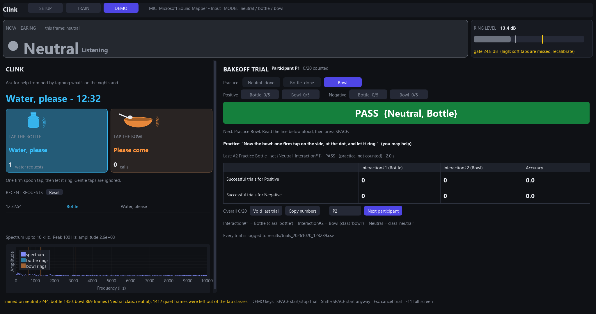

# Piezo Vibration Classification Starter

> **Our bakeoff project, Clink,** is built on the MIT-licensed course starter at <https://github.com/hilab-open-source/vibration-interaction-bakeoff>. We use the laptop's built-in microphone: a spoon tapping a steel water bottle is Interaction 1 ("Water, please"), tapping a ceramic bowl is Interaction 2 ("Please come"), and everything else is Neutral.
>
> - [docs/STORY.md](docs/STORY.md): the product story, the demo script and the experimenter guide for bakeoff trials.
> - [docs/PRESENTER_NOTES.md](docs/PRESENTER_NOTES.md): how the classifier works and what we changed from the starter.
>
> The app has three screens: SETUP, TRAIN and DEMO. On DEMO, SPACE starts a bakeoff trial and SPACE again stops it, then the app shows the set of labels seen in between and PASS or FAIL.

## Overview

This course starter lets you collect examples of vibrations, train a classifier, and run live inference on a laptop. A piezo sensor connected to the laptop's audio input acts as a contact microphone. A Dear PyGui desktop application calculates and displays FFT features, records labeled examples, trains a scikit-learn model, and shows predictions.

Unlike the other two audio starters, this project does not require an ESP32-S3 to collect data or run the provided application. A trained Linear SVM can be exported as a C++ header for later use in an ESP32 project.

## What you will build

You will create a custom vibration recognizer—for example, a classifier for tapping, scratching, knocking, or interactions with different surfaces. You will:

1. Capture vibrations through the laptop audio input.
2. Visualize their frequency spectra.
3. Record and label examples in the desktop application.
4. Train and evaluate a classifier on the laptop.
5. Optionally export a Linear SVM for ESP32.



*The DEMO screen. For this screenshot, a test script simulated the bottle request.*

## How this starter differs from the other audio starters

| Starter | Audio input | Model | Where inference runs |
| --- | --- | --- | --- |
| Sound classification | INMP441 on ESP32-S3 | Student-trained Linear SVM | Laptop or ESP32-S3 |
| Speech recognition | INMP441 on ESP32-S3 | Pretrained ESP-SR MultiNet6 | ESP32-S3 |
| **Vibration interaction (this project)** | Piezo sensor on laptop audio input | Student-trained scikit-learn classifier | Laptop; Linear SVM can be exported |

## Hardware

- Piezo sensor or piezo contact microphone
- Audio cable or adapter connecting the piezo signal to the laptop audio input
- A surface or object whose vibrations you want to classify

Select the piezo/audio input device in the application. If the laptop has no compatible analog input, use a USB audio interface with a microphone or line input. Begin with low input gain: piezo elements can produce large voltage spikes when struck. Use appropriate input protection or conditioning for your audio hardware.

## Software setup

Install Python 3.10 or later and [`uv`](https://docs.astral.sh/uv/getting-started/installation/). On macOS, install PortAudio first:

```bash
brew install portaudio
```

Then install the locked environment:

```bash
uv sync
```

Alternatively, create a Python 3.10 virtual environment and install the project:

```bash
python3.10 -m venv .venv
. .venv/bin/activate
pip install .
```

## Run the starter

With `uv`:

```bash
uv run visualizer.py
```

Or with the virtual environment active:

```bash
python visualizer.py
```

Choose the input device connected to the piezo sensor. The application remembers the selected device between sessions.

## Use the application

The application plots the live FFT spectrum with frequency in hertz on the x-axis and amplitude on the y-axis. A peak readout shows the strongest frequency and its current amplitude.

The top of the window always shows the live label (NOW HEARING) and the ring-level meter with the gate. The buttons at the top switch between three screens.

To train and use a model:

1. **SETUP:** click **Calibrate Quiet** and keep the room quiet for the next 3 s. Frames quieter than the resulting gate are treated as Neutral and are not recorded for the tap classes.
2. **TRAIN:** choose a model. `LinearSVC` is the default and can be exported for ESP32.
3. Add a `neutral` class and the tap classes `bottle` and `bowl`. The trial recorder maps classes with these names to Interaction 1 and 2; you can change the mapping in SETUP.
4. Select a class and click **Record Data**. For `neutral`, make everyday sounds (talking, typing, table taps) without making the objects ring.
5. Repeat the interaction under varied conditions, then stop recording. Recordings are saved automatically and reloaded at the next start.
6. Collect examples for every class and click **Train Model**. The app switches to **DEMO** when the model is live. Every trained model is also kept in `metadata/last_trained.model` and loaded again at the next start.
7. In SETUP, **frames to switch** sets how many non-Neutral frames in a row are needed before a tap is shown, and **sureness** (press Enter after typing) turns uncertain taps into Neutral. We use 5 and 0.50.
8. Optionally save the trained `.model` file, or load one with **Load Model**.

To run bakeoff trials on **DEMO**:

1. The app starts with participant P1. Use **Next participant** for each new person.
2. Read the bold line aloud, press **SPACE**, let the participant act, then press **SPACE** again. The banner shows the set (for example `{Neutral, Bottle}`) and PASS or FAIL, using the slide rules.
3. The recorder selects the three practice runs first (shown, never counted), then 5 trials each of Positive and Negative for both interactions. You can click another trial type at any time.
4. **Esc** cancels a running trial (INVALID, not counted). **Void last trial** undoes an experimenter mistake. **Copy numbers** copies the two spreadsheet rows.
5. Every trial is logged to `results/trials_<date>_<time>.csv`.

See [docs/STORY.md](docs/STORY.md#running-a-bakeoff-trial-experimenter-guide) for the full experimenter guide.

Collect all classes with the same sensor mounting, input gain, and object setup. Physical changes can shift the vibration spectrum and reduce accuracy.

## How it works

1. The laptop audio input captures mono samples from the piezo sensor or the built-in microphone.
2. `StreamAnalyzer` computes FFT amplitudes of the latest 50 ms of audio about 44 times per second (1103 bins at 44.1 kHz).
3. `get_audio_features()` returns those amplitudes for visualization and data collection.
4. A loudness gate (`frame_level_db()`, calibrated by **Calibrate Quiet**) marks frames whose strongest frequencies do not stand out above the room's noise as Neutral.
5. `preprocess_data()` takes log magnitudes and removes each frame's average, so the classifier sees spectral shape rather than loudness.
6. The selected scikit-learn classifier, wrapped with a `StandardScaler`, learns from the labeled vectors.
7. The same feature pipeline feeds the model during live inference; `LabelSmoother` and the sureness threshold steady the displayed label.
8. `trial.py` turns the displayed label of every fresh frame between two SPACE presses into the trial's set, judges it with the slide rules, keeps the per-participant tally and writes the CSV log.

See [docs/PRESENTER_NOTES.md](docs/PRESENTER_NOTES.md) for what we changed from the starter and why.

The graph shows frequencies up to 10 kHz. Its amplitude axis jumps up to fit a loud sound and then falls back over a few seconds, so both a quiet room and a ring are readable on the built-in microphone. Input devices may have different sample rates, gains, and analog conditioning, so data may not transfer directly between setups.

## Customize the starter

Most project-specific changes belong in `models.py`, which contains interfaces for features, preprocessing, training, prediction, persistence, and export.

- Modify `get_ear()` or `get_audio_features()` to experiment with FFT settings and features.
- Modify `preprocess_data()` to normalize or transform feature vectors.
- Modify `train_model()` to change the classifier or its parameters.
- Keep training and inference preprocessing identical.
- Retrain after changing FFT size, sample rate, bin count, preprocessing, sensor mounting, or input gain.

### Export a Linear SVM for ESP32

Train with `LinearSVC`, save the `.model` file, and convert it to a C++ header:

```bash
uv run export_model_header.py path/to/model.model vibration_model.h
```

Include the header in an ESP32 project and supply a feature vector with exactly the same length and preprocessing used for Python training:

```cpp
#include "vibration_model.h"

float features[VIBRATION_MODEL_NUM_FEATURES];

int class_index = vibration_model_predict_index(features);
const char *class_name = vibration_model_predict_name(features);
```

The export creates model code only. Your ESP32 firmware must separately sample the sensor and reproduce the laptop's FFT feature pipeline.

## Test and verify

The trial logic has unit tests (standard library only):

```bash
uv run python -m unittest tests.test_trial
```

For a functional check, launch the application, confirm that the selected input produces a changing spectrum, record the classes, train a model, and run one mock participant on **DEMO**.

## Troubleshooting

### No input device appears

- Connect the piezo or USB audio interface before starting the application.
- Grant microphone permission to the terminal or application running Python.
- On macOS, confirm PortAudio is installed.
- Restart after connecting a new audio device.

### The FFT plot does not react

- Select the input you trained with (the piezo input, or the built-in microphone for our project).
- Check the audio adapter, input gain, and piezo wiring.
- Try a gentle tap and watch the peak-amplitude readout.

### Predictions are inconsistent

- Collect more varied examples for every class.
- Keep sensor mounting and input gain fixed.
- Include a background class if the model must distinguish idle periods.
- Improve the features in `models.py` if classes have similar spectra.

## Project layout

| Path | Purpose |
| --- | --- |
| `visualizer.py` | Desktop app: SETUP / TRAIN / DEMO screens, live label, product view, trial recorder |
| `trial.py` | Bakeoff trial rules, per-participant tally and CSV log (no GUI; unit-tested) |
| `tests/test_trial.py` | Unit tests for `trial.py` |
| `models.py` | Features, models, persistence, and export |
| `src/stream_analyzer.py` | Audio buffering and FFT analysis |
| `src/stream_reader.py` | Audio-device discovery and capture |
| `src/utils.py` | Signal-processing utilities |
| `export_model_header.py` | Converts a Linear SVM to C++ |
| `tools/gonogo.py` | Hardware go/no-go test for a candidate pair of struck objects (written for an earlier steel bowl / glass jar design) |
| `src/svm_whistle_hiss.*` | Starter example model (old raw-amplitude features; not loadable by this version) |
| `docs/STORY.md` | Product story, demo script, experimenter guide, hard questions |
| `docs/PRESENTER_NOTES.md` | What we changed from the starter and why |
| `assets/` | Interface screenshots |
| `metadata/` | Saved preferences, recordings (`dataset.pkl`), calibration (`calibration.pkl`) and the last trained model; not committed |
| `results/` | Trial logs, one CSV per app run that ran trials; not committed |
| `pyproject.toml` / `uv.lock` | Python environment |
| `LICENSE` | MIT license |
